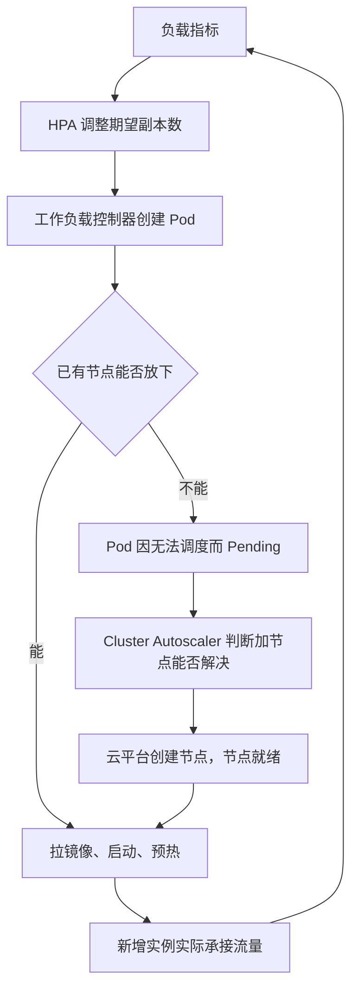

# Lecture 11：资源管理——伸缩

> 课程：SE3309 · 互联网产品开发与运维
> 授课教师：任锐
> 课件日期：2026-10-27
> 模块：模块 6 · 资源管理（3/3）
> 来源：[L-11.pdf](/Users/xlchen/RR-fa26/lectures/L-11.pdf)，共 29 页。下文页码均指 PDF 页码。
> 本笔记按课件整理；“课件讲评”保留课堂结论，“按题设计算”补全推导，“补充理解”说明适用条件。流量、启动时间、连接数与成本均为教学设定或推算，不是实测结果。课件提到的 `l11_numbers.py` 未随当前仓库提供，具体演练时刻以课件记录为准；关键算术已单独核对，少量实现细节附官方资料。

## 1. 本讲主线：从“放哪儿”到“何时变”（pp.3–4）

[Lecture 10](/Users/xlchen/RR-fa26/notes/lecture-10.md) 给出开放日放置方案：**3 个节点、6 个 Tomcat，按 2、2、2 分布，坏一个节点仍有 4 个可用。** 但平时一直维持这个规模，比 2 个同规格节点多付 50% 的节点费用。

本讲回答：**流量变了，容量如何及时跟着变，既满足服务目标，又减少闲置成本？**

| 问题 | 要判断什么 | 对应方案内容 |
| --- | --- | --- |
| 扩哪一层？ | 瓶颈是否位于能扩展的那一层 | 伸缩对象、下游约束 |
| 何时变？ | 需求何时到来，新增容量多久就绪 | 定时、反应式、预测式 |
| 怎么变？ | 用什么指标，扩多少，缩多快 | 目标值、上下限、稳定窗口 |
| 实例和节点怎么配合？ | 新实例有无空位，空节点能否释放 | 两层控制环与成本 |

引例把平时规模缩到 **2 个节点、2 个 Tomcat**，开放日交给按 CPU 的自动伸缩，出现两个症状：

- **症状 A：赶不上。** 读流量在 30 s 内从 100 增至 2400 QPS，新实例到 9:01:35 才就绪。
- **症状 B：扩错层。** 降低目标、提高上限后扩到 7 个 Tomcat，提交报 `Too many connections`。

本讲产出是一张**弹性方案**。判断标准是：**这份容量什么时候需要、多久能到位？扩上去以后，下一个到上限的是谁？**

沿用 L-05 的两个前提：状态放在实例之外，实例启动足够快。无状态使实例容易替换，启动速度决定它能否及时贡献容量。

## 2. 扩哪一层：先找瓶颈，再谈加实例（pp.6–7）

### 2.1 选课平台各层的处理方式

| 层 | 本案例能否靠增加实例提高处理能力 | 前提或限制 | 课程方案 |
| --- | --- | --- | --- |
| Nginx 入口 | 可以扩展，本讲不展开 | 还需入口流量分配与高可用机制 | 不纳入本讲自动伸缩 |
| Tomcat | 可以，是本讲对象 | 状态在外部；瓶颈确实在应用层；下游仍有容量 | 水平调整副本数 |
| 批处理 | 本案例不需要自动扩展 | 可重跑、可放慢或被抢占 | 低优先级填补空闲资源 |
| MySQL 写 | 单纯加 Tomcat 或读副本不能解决 | 本例上限在磁盘 fsync，约 250 TPS | 写入口限流、组提交、调整写路径 |
| MySQL 读 | 可通过读副本扩展，但准备慢 | 数据复制、追赶、切流有成本，课件按小时级理解 | 提前准备，不进入本讲反应式伸缩 |

判断顺序：**用 L-08 的 USE 方法找饱和资源 → 确认所在层 → 判断增加该层实例能否分摊工作 → 检查下游预算。**

课件的“有状态不能扩”应按当前架构理解：数据库也有复制、分片、纵向调整等扩展方式，但不等于给现有单主写路径多加几个应用实例就能增加写吞吐。

### 2.2 扩上游会把压力传给下游

| 约束 | 加 Tomcat 后发生什么 | 可能出现的现象 |
| --- | --- | --- |
| 数据库连接数 | 每个实例带来自己的连接池 | 总连接超过上限，建立连接失败 |
| 热点锁与 fsync | 更多事务争抢同一热点或磁盘 | 锁等待增加，提交 p99 变差 |
| 在途请求 | 下游慢使请求停留更久 | 按在途数伸缩时，继续错误地扩上游 |

连接预算的基本条件是：

```text
所有应用实例的连接池容量之和 + 其他连接 ≤ 数据库连接预算

相同池大小时：
最大应用实例数 = ⌊(数据库连接预算 − 其他连接) / 单实例池大小⌋
```

**补充理解：**HikariCP 的 `minimumIdle` 默认等于 `maximumPoolSize`，会尝试维持固定大小的连接池；这不保证所有连接在进程启动的同一瞬间就全部建好。课件将其简化为“实例一启动就建满”，用于计算扩容带来的连接需求。无论实际建连快慢，上限规划都应考虑池最终可能占用的连接。[HikariCP：连接池配置](https://github.com/brettwooldridge/HikariCP#configuration-knobs-baby)

连接数没超也不表示数据库一定扛得住：磁盘吞吐、锁等待等可能更早达到上限。**伸缩上限应由下游最紧的约束决定。**

## 3. 何时变：三种触发方式（pp.9、11）

| 方式 | 决策依据 | 适合 | 主要失效情形 |
| --- | --- | --- | --- |
| 定时（scheduled） | 已知时间表 | 选课开放日、固定业务高峰 | 开放时间变化，实际流量高于预计 |
| 反应式（reactive） | 当前观测指标超过目标 | 无法准确预知的波动 | 负载爬升快于控制环与启动速度 |
| 预测式（predictive） | 历史曲线预测未来负载 | 有稳定周期的业务 | 新事件没有历史，规律变化，预测错误 |

课件的产品对应：华为云 AS 有告警、定时、周期触发策略；Kubernetes HPA 属于反应式控制。定时调整 HPA 下限，需要另有定时执行机制。

组合方式：**定时提前提供基本容量，反应式处理可承受的偏差，预测帮助决定提前开多少。**

定时规划要回答两个独立问题：

1. **提前多久？** 按新增容量就绪的最长路径，再加余量。
2. **开多少？** 按峰值需求和故障后的容量要求，不只按平均利用率目标。

预热是在用钱换提前量。开放推迟意味着多付机器时间，预测偏低则可能消耗开放日的错误预算，需要结合 L-08 的 SLO 权衡。

## 4. 控制环延迟：有决策，不等于有容量（p.10）

### 4.1 延迟由哪些部分组成

```text
负载变化
  → 指标采集、传输与聚合
  → 等待下一次伸缩决策
  → 修改期望副本数、创建实例、调度
  → 若无空位，等待新增节点
  → 拉镜像
  → 启动、预热、通过就绪检查
  → 新实例真正接流量
```

课件用以下数字做近似串行估算：

| 阶段 | 题设时间 | 含义 |
| --- | --- | --- |
| 指标延迟 | 约 20 s | 控制器看到的是过去的负载 |
| 等待决策 | ≤ 15 s | 周期性检查，不是连续即时响应 |
| 拉镜像 | 约 20 s | 可通过预拉镜像等方式优化 |
| 启动与预热 | 约 60 s | 进程启动后还需具备服务能力 |
| 新增节点 | 约 4 min | 只有原节点放不下时才走这段路径 |

```text
已有空位：20 + 15 + 20 + 60 = 115 s，约 2 min
需要加节点：115 + 240 = 355 s，约 6 min
```

这些是本例的估算，不是平台承诺的上界；真实过程还受调度、节点注册、探针、重试等影响。已知时间的定时预热可以提前发出指令，不必先等负载升高形成指标。

### 4.2 爬升速度与预留余量

若需求近似按速度 r 持续上升，在延迟 τ 内旧容量需要吸收：

```text
所需余量 H ≥ r × τ
```

本例读流量：

```text
r = (2400 − 100) / 30 ≈ 76.7 QPS/s
若把该斜率外推 100 s：H ≈ 7667 QPS，课件取约 7700 QPS
```

**适用条件：**这个乘法假定斜率在整段延迟内持续。实际流量只爬升 30 s，随后保持峰值，不能据此说本例实际需要 7700 QPS 的额外容量。更一般的条件是：

```text
H ≥ 控制环延迟内，需求相对起点的最大增量
```

本例真正的问题是：**新增实例至少要经过 80 s 的拉镜像与启动，而峰值只用 30 s 就到来，原有容量又不足以覆盖峰值。** 因而只调低目标或缩短决策周期，仍无法消除这次缺口。

可采取的办法是提前预热、保留足够热容量，或实际缩短镜像与应用启动路径；未知且无法及时承接的突发，还需要限流和降级。

## 5. HPA 目标追踪：目标按 request 计算（p.13）

### 5.1 基本公式与计算口径

在指标可用、实例可比的简化条件下：

```text
期望副本数 = ⌈当前副本数 × 当前指标 / 目标指标⌉

CPU 利用率 = CPU 实际用量 / CPU request
```

本例每个 Tomcat 的 CPU request 为 2.6 核、limit 为 4 核：

| 数值 | 计算 | 用途 |
| --- | --- | --- |
| 2.6 核 | CPU request | 调度记账、HPA 利用率分母 |
| 4 核 | CPU limit | 运行时 CPU 用量上限 |
| 1.82 核 | `2.6 × 70%` | HPA 目标 70% 对应的单实例用量 |
| 2.8 核 | `4 × 70%` | L-07 沿用的单实例规划容量线 |

**两个 70% 的分母不同，1.82 核与 2.8 核不能互换。** 规划容量线用于保留性能余量，也不是 p99 的数学保证。

用量超过 request 时，CPU 利用率可以超过 100%。例如：

```text
每个实例用 3.03 核：3.03 / 2.6 ≈ 116.5%
当前 2 个实例、目标 70%：⌈2 × 116.5 / 70⌉ = 4
```

实际 HPA 还会处理容差、缺失指标、未就绪实例、速率限制和副本上下限，不能只套这一行公式。[Kubernetes：HPA 算法](https://kubernetes.io/docs/concepts/workloads/autoscaling/horizontal-pod-autoscale/#algorithm-details)

### 5.2 课件列出的默认行为

| 项目 | 默认值 / 行为 | 容易误解的地方 |
| --- | --- | --- |
| 决策周期 | 15 s | 每次决策仍可能拿到旧指标 |
| 容差 | 与目标的比例偏差在 10% 内不动作 | 是相对目标的偏差，不是上下 10 个百分点 |
| 扩容稳定窗口 | 0 s | 不人为等待稳定窗口，启动时间仍然存在 |
| 扩容速率 | 每 15 s 最多增加当前数量的 100%，或 4 个，取允许增加更多的策略 | 是允许的增长上限，不是每轮一定增加这么多 |
| 缩容稳定窗口 | 300 s，采用窗口内最大的建议值 | 不是每次修改配置都强制重新等待 5 min |
| 未就绪实例 | CPU 扩容计算中可能按 0% 做保守修正 | 防止新实例尚未贡献容量时继续过度扩容 |

例如目标为 70%，10% 相对容差大致对应 63%～77%。对当前 2 个实例，扩容速率限制允许一次最多增加 `max(2, 4) = 4` 个；但本例算法只建议增加 2 个，因此扩到 4 个。

以上为课件采用的默认配置，部署时可以调整。[Kubernetes：HPA 默认行为](https://kubernetes.io/docs/concepts/workloads/autoscaling/horizontal-pod-autoscale/#default-behavior)

### 5.3 为什么 9:00:30 没有继续扩

课件记录：9:00:15 把期望数量从 2 改到 4；9:00:30 新建的 2 个仍未就绪，修正后的比例落在容差内。

按题设可以理解为：旧的 2 个实例各自已被 4 核 limit 封顶，新的 2 个在扩容计算中按 0 计：

```text
修正平均利用率 = (4 + 4 + 0 + 0) / (4 × 2.6)
               ≈ 76.92%

修正后与目标之比 = 76.92% / 70% ≈ 1.0989
相对偏差 ≈ 9.89% < 10%，不再扩容
```

这解释了“用户正在排队，控制器却没继续加”的可能原因：**CPU 指标只看到实际得到的 CPU，加上对未就绪实例的保守处理，不能完整反映尚未满足的需求。** 实际采样区间与就绪判定也会影响结果。

### 5.4 平均负载需要 5 个，为何开放日要保留 6 个

对 8.7 核稳态需求，忽略容差等修正的目标追踪建议为：

```text
按 HPA 目标：⌈8.7 / 1.82⌉ = 5 个
按单实例规划容量：⌈8.7 / 2.8⌉ = 4 个
按 L-10 的单节点故障要求：6 个，放成 2、2、2
```

三个数字回答不同问题：达到利用率目标、平时提供足够容量、故障后仍有足够容量。

5 个按 2、2、1 放置，丢掉一个有 2 个实例的节点后只剩 3 个，规划能力为 `3 × 2.8 = 8.4` 核，小于 8.7 核。因此开放日需要把 **`minReplicas` 调到 6**，让 CPU 控制器不能缩掉故障冗余。

## 6. 选什么信号：它必须反映被扩层的压力（p.14）

| 信号 | 反映什么 | 优点 | 局限 |
| --- | --- | --- | --- |
| CPU 利用率 | 已实际消耗的计算资源 | 通用，无须业务埋点 | 等忙起来才看到；被 limit 封顶；I/O 等待不一定高 CPU |
| 请求速率 QPS | 到达量 | 可以较早看到流量爬升 | 需压测单实例能力；读写比例、请求成本变化后需重新标定 |
| 在途请求数 | 到达率与停留时间共同作用 | 能反映请求积压 | 下游变慢也会增加在途数，可能误扩上游 |
| 队列积压 lag | 异步消费者尚未完成的工作 | 直接反映欠账 | 扩容还要求任务可并行、分区足够、下游有容量 |

### 6.1 CPU 封顶会隐藏需求

```text
最大可见 CPU 利用率 ≈ limit / request
                    = 4 / 2.6 ≈ 153.85%

相对 70% 目标的原始倍率 ≈ 153.85 / 70 ≈ 2.20
```

课件把它概括为“每次最多约 2.2 倍”，这里指**CPU 指标能给出的原始倍率**。最终副本数还要取整，并受扩容速率、未就绪实例和 `maxReplicas` 等约束。

CPU 已用满以后，更高的需求主要体现为排队或超时，利用率不会随需求无限增长。

### 6.2 在途数增加，可能是在等下游

在适用的稳定统计区间，Little's Law 给出：

```text
在途请求数 L = 到达率 λ × 平均停留时间 W
```

即使 λ 不变，数据库变慢使 W 增加，也会使 L 增加。若控制器因此不断加 Tomcat，连接与并发事务进一步增加，又可能让数据库更慢。

选信号时要说明：**指标上升为何能通过增加这一层的实例得到缓解？** QPS 较早暴露需求，也仍然绕不开实例启动时间和下游上限。

## 7. 稳定与缩容：扩快缩慢，退出也要完整（p.15）

### 7.1 为什么会抖动

```text
扩容 → 每实例负载降低 → 触发缩容
     → 每实例负载升高 → 又触发扩容 → ……
```

这种反复增减称为抖动（flapping）。代价包括重复启动预热、连接创建销毁、容量波动，以及刚缩完就出现新峰值时的等待。

课件采用 300 s 缩容稳定窗口，保留窗口内较高的建议值，让短暂低谷不立刻变成缩容动作。“扩快缩慢”是在响应速度与稳定性之间做取舍。

### 7.2 缩容就是一次优雅停止

```text
停止接收新请求、从负载均衡摘除
  → 等待在途请求完成
  → 关闭数据库连接池等资源
  → 进程退出
```

课件按最多 30 s 等待在途请求理解。部署时需要让摘流、应用的停止逻辑与终止宽限期相配合；超过宽限期仍未结束的请求，不能仅靠“优雅停止”四个字保证不丢。

长任务还需检查点、幂等和可恢复设计。批处理能重跑，意味着承担重跑成本，并不表示任意时刻终止都没有损失。

## 8. 两层伸缩：实例决定容量，节点影响成本（pp.15、17）

### 8.1 两个控制环如何衔接



| 控制器 | 调什么 | 看什么 | 典型时间尺度 |
| --- | --- | --- | --- |
| HPA | 工作负载的期望副本数 | CPU 或配置的其他指标 | 秒到分钟 |
| Cluster Autoscaler，简称 CA | 节点组规模 | 无法调度的 Pod、request 与放置可行性 | 分钟 |

HPA 不直接创建云主机。CA 也不是看到所有 Pending 就盲目加节点：新增节点必须有可能满足该 Pod 的资源与调度条件，并且节点组允许增长。

本例每个节点按内存只能放 2 个 Tomcat。平时已有 2 个节点、各 1 个 Tomcat，所以：

```text
现有 2 个 + 还能放 2 个 = 总共 4 个
第 3、4 个 Tomcat：使用现有空位
第 5 个 Tomcat：需要第 3 个节点
```

课件 p.17 的“第 3 个起”应理解为**本次新增的第 3 个，即总数的第 5 个**，否则会与同页的 2 个空位矛盾。演练记录中，第 5 个到 **9:07:20** 才就绪。

### 8.2 节点缩容按 request 判断

课件列出的 CA 默认配置包括：约每 10 s 扫描；节点持续约 10 min 不再需要才考虑移除；扩容后约 10 min 才恢复缩容评估。

普通 CPU / 内存节点的低利用判断，可写成：

```text
request 占比 = max(ΣCPU request / 可分配 CPU,
                  Σ内存 request / 可分配内存)

request 占比 < 50%，才满足默认低利用候选条件
```

此外，节点上的 Pod 必须能在其他节点安置，并符合驱逐限制、节点组最小规模等条件。**实际 CPU 用量很低，不等于节点可删除；节点上有 Pod，也不等于一定不能删除。**[Cluster Autoscaler：缩容条件与参数](https://github.com/kubernetes/autoscaler/blob/master/cluster-autoscaler/FAQ.md#how-does-scale-down-work)

### 8.3 实例少了，账单不一定少

本讲按节点·小时计费：

- 缩掉 Pod，释放的是节点上的资源占位。
- 节点仍在计费，节点费用就没有同步减少。
- 若低优先级批处理利用这些空闲资源，可以提高资源利用率，但不等于已经减少机器数量。

因此弹性方案必须同时规定实例何时减少，以及节点如何真正释放。

## 9. 水平、纵向与其他伸缩方式（p.18）

| 方式 | 改什么 | 本讲适用场景 | 主要限制 |
| --- | --- | --- | --- |
| 水平伸缩 HPA | 副本数 | 无状态 Tomcat | 状态外置、可分摊负载、连接预算、节点空位 |
| 纵向伸缩 VPA / 资源调整 | 单实例 request、limit | 难以水平扩的组件，或配额估计不准的服务 | 单节点资源上限；更新方式可能涉及重启或重建 |
| 云主机伸缩组，如 AS | 云主机台数 | 没有容器编排的部署 | 粒度较粗，新增主机后仍需应用就绪 |
| Serverless | 平台管理的执行实例、并发容量 | 低频接口，可缩到零的场景 | 冷启动、并发额度与平台响应速度 |

课件记载 Kubernetes 原地调整 Pod 资源自 v1.35 起成为正式功能，同时将 VPA 原地更新模式标为 beta。两者是不同层次：**平台能原地改资源，不等于所有 VPA 更新都不会中断。** 例如 `InPlaceOrRecreate` 模式在不能原地调整时可以退回驱逐重建，应核对实际版本和模式。[Kubernetes：原地调整正式发布](https://kubernetes.io/blog/2025/12/19/kubernetes-v1-35-in-place-pod-resize-ga/)、[VPA 更新模式](https://kubernetes.io/docs/concepts/workloads/autoscaling/vertical-pod-autoscale/#inplaceorrecreate)

本案例 Tomcat 水平伸缩；MySQL 不进入自动弹性层，规格调整通过计划变更、停机或主从切换完成。课件对 Serverless 的限制针对本例的冷启动与突发需求，不能推广为所有 Serverless 产品都无法承接突发。

## 10. 贯穿案例的参数与资源账（p.20）

### 10.1 题设汇总

| 项目 | 数值 / 设定 |
| --- | --- |
| Tomcat CPU | request 2.6 核，limit 4 核 |
| Tomcat 内存 | 沿用 L-09 / L-10：request 与 limit 均为 5.5 GB |
| 池内节点 | 沿用 L-10：8 核、16 GB，每节点最多 2 个 Tomcat |
| 平时规模 | 2 个节点、2 个 Tomcat，分散放置 |
| 开放日故障冗余方案 | 3 个节点、6 个 Tomcat，按 2、2、2 放置 |
| 读请求 CPU 成本 | 每次 3 ms |
| 写请求 CPU 成本 | 每次 5 ms |
| 读流量 | 8:59:30 起，30 s 内由 100 增至 2400 QPS；维持到 9:10；9:30 降到约 300 QPS |
| 写到达量 | 9:00 起前 10 s 为 600 TPS，随后为 300 TPS；缩容阶段不据此假定永远保持 300 |
| MySQL 写能力 | 约 250 TPS，由 fsync 等写路径约束 |
| 初始反应式策略 | CPU 目标 70%，副本范围 2～6 |
| 镜像 / 启动 / 节点 | 20 s / 60 s / 约 4 min |
| 数据库连接 | 每个 Tomcat 池大小 20；批处理 10；其他约 5；`max_connections = 151` |
| 成本口径 | 一学期 120 天，3 个开放日，按节点·小时计费 |

### 10.2 需求、实际用量与规划容量要分开

```text
CPU 需求（核） = 读 QPS × 0.003 + 写到达率 × 0.005

开放前读高峰：2400 × 0.003 = 7.2 核
开放后前 10 s：7.2 + 600 × 0.005 = 10.2 核
之后的高峰稳态：7.2 + 300 × 0.005 = 8.7 核
```

这里的写到达率表示希望处理的工作量，不代表数据库实际成功完成这么多事务。写吞吐受下游限制，CPU 需求估算也不能替代数据库容量校验。

| 就绪 Tomcat 数 | 按 2.8 核 / 个的规划容量 | CPU limit 总和 | 用途 |
| --- | --- | --- | --- |
| 2 | 5.6 核 | 8 核 | 解释最初为什么承压不足 |
| 4 | 11.2 核 | 16 核 | 新增 2 个就绪后，覆盖本例 CPU 需求 |
| 5 | 14 核 | 20 核 | 满足稳态 HPA 目标，但故障冗余不足 |
| 6 | 16.8 核 | 24 核 | 按 2、2、2 放置，丢一节点仍有 4 个 |

limit 总和不保证能同时获得这么多 CPU；还取决于节点实际资源、同机负载与调度分布。表中的“容量够”也只检查 Tomcat CPU 这一项，不自动证明端到端 SLO 达标。

## 11. 课堂讨论：四个问题的完整推导（pp.21–23）

### 11.1 问题一：方案 B 的缺口何时开始、何时结束

**方案 B：平时保留 2 个 Tomcat，开放日只靠反应式扩容。**

设 t 为 8:59:30 后的秒数，在 `0 ≤ t ≤ 30` 的线性爬升段：

```text
读 QPS(t) = 100 + (2300 / 30)t
读 CPU 需求 D(t) = 0.003 × [100 + (2300 / 30)t]
                 = 0.3 + 0.23t 核

原有规划容量：2 × 2.8 = 5.6 核
交点：0.3 + 0.23t = 5.6
t ≈ 23.04 s
```

因此 **8:59:53 左右开始超过原有规划容量**。

| 时刻 | 发生什么 | 对容量的影响 |
| --- | --- | --- |
| 8:59:30 | 读流量开始爬升 | 就绪实例仍为 2 个 |
| 约 8:59:53 | 需求超过 5.6 核规划线 | 开始消耗性能余量 |
| 9:00:00 决策 | 看到 8:59:40 的数据，每个约 1.3 核，即 request 的 50% | 不扩容 |
| 9:00:00～9:00:10 | 需求为 10.2 核 | 超过 2 个实例合计 8 核 limit，工作排队 |
| 9:00:15 决策 | 看到 8:59:55，每个约 3.03 核，利用率约 116% | 期望数量改为 4，使用现有 2 个空位 |
| 9:00:30 决策 | 新实例仍未就绪，保守修正后落入容差 | 没有继续扩 |
| 9:01:35 | 新建的 2 个实例完成 20 s 拉镜像与 60 s 预热 | 就绪数为 4，规划容量增至 11.2 核 |
| 9:07:20 | 课件演练中的第 5 个实例就绪 | 经历了新增节点路径，规划容量增至 14 核 |

```text
容量缺口区间：约 8:59:53～9:01:35
持续时间：约 102 s，课件概括为约 100 s
```

要区分两个时段：8:59:53 后先超过留有余量的规划线；9:00 后 10.2 核、8.7 核需求又都超过了 8 核 limit 总和，出现更明确的 CPU 供给不足。

9:01:35 表示**新增容量已足以覆盖当前需求**，不表示此前积压的请求在这一瞬间全部清空，更不表示 MySQL 写瓶颈已经消失。

调参能减少指标等待与决策等待，却不能直接删除 80 s 的镜像和启动时间。解决本次已知高峰，应提前准备容量；优化启动路径后，也要重新演练才能确定新的提前量。

### 11.2 问题二：方案 C 最晚何时开始，一学期省多少

**方案 C：开放日前定时提高最少副本数到 6，并准备 3 个节点。**

最长就绪路径的题设估算是：

```text
新增节点 + 拉镜像 + 启动预热 = 240 + 20 + 60 = 320 s
                                           = 5 min 20 s

若要求 9:00 就绪：9:00:00 − 5:20 = 8:54:40
若要求读流量爬升前就绪：8:59:30 − 5:20 = 8:54:10
```

课件选 **8:50 开始**，为控制器处理、节点准备等不确定性留余量。这两个“最晚”时刻仅按题设相加得出，不能当成实际系统的安全启动截止线。

成本比较：

| 方案 | 计费模型 | 一学期节点·小时 |
| --- | --- | --- |
| A：3 个节点常驻 | `3 × 24 × 120` | 8640 |
| C：平时 2 个，3 个开放日各多 1 个约 80 min | `2 × 24 × 120 + 3 × 80 / 60` | 5764 |

```text
每次额外节点时段：8:50～约 10:10，共 80 min = 4/3 h
节省量：8640 − 5764 = 2876 节点·小时
节省比例：2876 / 8640 ≈ 33.29%
```

按同规格、同单位价格且释放节点即停止相应计费的假设，节点计算费用也约省 33%。这是这部分节点的成本，不是整个系统总账单；课件没有给出单价，不能换算成具体金额。

**开放推迟：**把定时安排与实际开放时间联动，已经多开的时长照常计入成本。

**流量超预期：**反应式只能在既定上下限内兜底。开放日 `minReplicas = maxReplicas = 6` 时，已经没有继续增加副本的空间，应重新检查需求、故障余量与下游瓶颈，必要时限流、降级或提前修改整体容量方案。

例如只把读流量翻倍，写稳态仍为 300 TPS：

```text
CPU 需求 = 4800 × 0.003 + 300 × 0.005 = 15.9 核
6 个正常时的规划能力 = 16.8 核
坏一节点后 4 个的规划能力 = 11.2 核
```

正常时的 CPU 算术可能放得下，但原有单节点故障保证已经不足。若读写都翻倍，需求为 17.4 核，连 6 个的规划容量也超过了。

### 11.3 问题三：目标 50%、上限 10，为什么扩到 7 个就出错

调低目标，会提高同一负载下的副本建议数：

```text
目标 50% 对应单实例用量 = 2.6 × 0.5 = 1.3 核
8.7 核稳态需求对应：⌈8.7 / 1.3⌉ = 7 个
```

但连接预算为：

```text
可供 Tomcat 使用的连接 = 151 − 10 − 5 = 136
最大实例数 = ⌊136 / 20⌋ = 6

6 个：6 × 20 + 10 + 5 = 135 ≤ 151，剩余 16
7 个：7 × 20 + 10 + 5 = 155 > 151，超出 4
```

因此第 7 个连接池尝试补足连接时，可能触发 `Too many connections`。把 HPA 上限写成 10，并不会让数据库多出连接或磁盘能力。

**本例上限应为 6 个。** 更一般地，还要检查连接以外的资源，以及扩缩容、滚动发布期间新旧实例重叠所带来的临时连接；不能只统计最终稳态副本。

提交变慢的另一个原因是写到达率 600 / 300 TPS 高于约 250 TPS 的数据库写能力。多加 Tomcat 只会让更多事务同时等待，无法直接提高 fsync 上限。

课件的处理方向：写入口按约 250 TPS 限流，实验中观察组提交，或按思考题 2 调整名额扣减等写路径。限流意味着超出部分需要明确拒绝、排队或降级；实际阈值仍要结合延迟目标和压测校准。

### 11.4 问题四：什么时候缩，怎样缩才不丢请求

**课件讲评：**9:30 把最少副本数改回 2，此时读流量约 300 QPS，读 CPU 需求约 `300 × 0.003 = 0.9` 核，课件约记 1 核；按 300 s 稳定窗口，约 9:35 缩回 2 个，并逐个优雅退出。批处理约 10:00 结束，节点保守估计约 10:10 缩回 2 个。

需要补充四个边界：

1. **9:10 高峰结束，不等于立刻删除冗余。** 方案把开放日下限维持到 9:30，覆盖后续负载变化。
2. **0.9 核只是读请求需求。** 缩容时还需确认当时的写流量、批处理干扰和在途请求，不能直接把峰值阶段的 300 TPS 一直外推到 9:30。
3. **9:35 是讲评估算。** 稳定窗口看历史建议值，并不是修改 `minReplicas` 后必定重新计时 300 s；实际还取决于指标延迟、历史建议和缩容策略。
4. **10:10 是保守规划时刻。** CA 可以迁走符合条件的 Pod，再删除非空节点；“批处理没结束”本身不是绝对阻挡条件。若方案要求等任务结束，就要落实相应的任务保护或缩容策略。低利用持续时间、可迁移性与节点组下限仍需检查。

防止请求损失的核心是第 7 节的摘流、排空、关闭连接池和退出流程，并为可能超过宽限期的任务设计恢复方法。最终剩下的 2 个 Tomcat 也应分散到 2 个节点，才能维持平时的单节点故障余量。

## 12. 最终参考弹性方案（p.24）

### 12.1 时间表与约束

| 时间 / 阶段 | Tomcat | 节点 | 需要确认的结果 |
| --- | --- | --- | --- |
| 平时 | 最少 2，按 CPU 指标在允许范围内调整 | 基础规模 2 | 2 个基础副本分散，低峰故障后仍能承压 |
| 开放日 8:50 | 将 `minReplicas` 提到 6 | 准备扩至 3 | 这是发出期望状态，不是 6 个立即就绪 |
| 8:59:30 前 | 6 个已预热、就绪 | 3 个已就绪 | 2、2、2 分布；连接、负载均衡与下游正常 |
| 9:00～9:10 | 保持 6 个 | 保持 3 个 | 前 10 min 的服务目标与故障余量 |
| 9:10～9:30 | 下限继续为 6 | 维持所需容量 | 不因短时负载下降而过早删除冗余 |
| 9:30 以后 | 下限改回 2，按稳定窗口逐步缩容 | 先保留，再评估 | 摘流与在途请求排空；讲评约 9:35 缩回 2 个 |
| 批处理结束后 | 平时规模 | 满足条件后恢复 2 个 | 课件按约 10:10 计费结束估算 |

| 约束项 | 参考值 | 依据 |
| --- | --- | --- |
| 最少副本 | 平时 2；开放日 8:50～9:30 为 6 | 平时需求、开放日故障域容量 |
| 最多副本 | 6 | MySQL 连接预算 |
| 反应式信号 | CPU 目标 70%，分母是 request | 作为允许范围内的调整机制 |
| 缩容稳定窗口 | 300 s | 减少抖动 |
| 节点基础规模 | 2 | 平时保留两个故障域 |
| 开放日放置 | 3 个节点，每节点 2 个 | 沿用 L-10 |
| 写入口 | 约 250 TPS 限流 | 本例数据库写能力 |

**下限由可用性要求决定，上限由下游预算决定，提前量由就绪路径决定。** 若三者彼此冲突，说明要调整架构、单实例资源、连接池或服务目标，不能靠改一个伸缩阈值解决。

### 12.2 HPA 配置示意

以下只表达本讲的 HPA 参数；假定已有名为 `tomcat` 的 Deployment、CPU request 和指标采集服务：

```yaml
apiVersion: autoscaling/v2
kind: HorizontalPodAutoscaler
metadata:
  name: tomcat
spec:
  scaleTargetRef:
    apiVersion: apps/v1
    kind: Deployment
    name: tomcat
  minReplicas: 2
  maxReplicas: 6
  metrics:
    - type: Resource
      resource:
        name: cpu
        target:
          type: Utilization
          averageUtilization: 70
  behavior:
    scaleDown:
      stabilizationWindowSeconds: 300
```

定时机制只在**开放日**按计划修改 `minReplicas`：8:50 改为 6，9:30 改回 2。只手动把 Deployment 的副本数改成 6，不能持久表达开放日容量下限，后续仍可能被 HPA 调整。

节点伸缩、故障域分布、就绪检查、优雅停止与写入口限流还需分别配置。落地后应演练完整链路，确认“发出扩容指令”最终变成“所需数量已就绪”。

## 13. 公式速查与易混淆概念

| 要计算什么 | 公式 / 方法 | 使用前提 |
| --- | --- | --- |
| CPU 需求 | `Σ(请求率 × 单次 CPU 秒数)` | 请求类型与成本已知，单位一致 |
| HPA CPU 利用率 | `实际 CPU 用量 / CPU request` | CPU request 与指标有效 |
| 目标追踪原始建议 | `⌈当前副本数 × 当前指标 / 目标值⌉` | 再处理容差、就绪、上下限和速率策略 |
| 同规格实例稳态建议 | `⌈总 CPU 用量 / (request × 目标比例)⌉` | 负载可分摊、指标完整，未计其他修正 |
| 规划容量 | `就绪实例数 × 单实例规划能力` | 实例与节点确实能提供相应能力 |
| 连接数上限 | `⌊(总预算 − 其他连接) / 单实例池大小⌋` | 还需考虑临时重叠、连接波动和其他瓶颈 |
| 任一节点故障后够用 | `总副本数 − 单节点最多副本数 ≥ 所需副本数` | 同能力副本，故障后下游仍可用 |
| 反应式余量估计 | `余量 ≥ 爬升速度 × 控制环延迟` | 斜率在该时间段持续；有限峰值用实际最大增量 |
| 定时最晚开始时刻 | `容量就绪截止时刻 − 最长就绪路径 − 余量` | 以演练测得的延迟校准 |
| 节点·小时 | `Σ(节点数量 × 对应计费时长)` | 不同规格需另乘各自单价 |
| 节省比例 | `(原成本 − 新成本) / 原成本` | 相同统计范围 |

| 易混淆项 | 区别 |
| --- | --- |
| request / limit / 规划容量线 | 申请与记账 / 运行时上限 / 留有余量的设计能力 |
| HPA 的 70% / L-07 的 70% | 本例分别对应 1.82 核 / 2.8 核 |
| 期望副本 / 就绪副本 | 控制器想要几份 / 已能实际接流量的几份 |
| CPU 需求 / CPU 实际用量 | 想完成的工作需要多少 / 实际获得并消耗了多少 |
| 满足利用率目标 / 满足故障冗余 | 平均指标合适 / 坏一个故障域后仍够用 |
| 下调利用率目标 / 增加数据库能力 | 前者倾向增加应用副本，后者不会自动发生 |
| 缩容稳定窗口 / 固定等待计时器 | 参考一段历史建议 / 每次事件后机械等待固定时间 |
| 缩 Pod / 缩节点 | 释放资源占位 / 有机会减少节点计费 |
| 连接数充足 / 写吞吐充足 | 能建立连接 / 能及时完成事务 |
| CPU 缺口结束 / 请求延迟恢复 | 当前容量覆盖新需求 / 还要清空积压并处理下游瓶颈 |

## 14. 复习自测

1. **为什么打开自动伸缩，仍可能错过开放日高峰？**

   观测、决策、调度、拉镜像与预热都要时间；本例爬升仅 30 s，新增容量来不及到位。

2. **目标 CPU 70%，request 2.6 核、limit 4 核，对应多少核？**

   HPA 目标为 `2.6 × 0.7 = 1.82` 核。2.8 核是另一套规划容量口径。

3. **CPU 利用率 116% 是否表示违反了 limit？**

   不一定。分母是 request；约 3.03 核高于 2.6 核 request，但低于 4 核 limit。

4. **2 个实例各用 3.03 核，目标 70%，原始建议是多少？**

   `⌈2 × (3.03 / 2.6) / 0.7⌉ = 4` 个。

5. **为什么新实例未就绪时，HPA 可能暂不继续扩？**

   CPU 扩容计算会保守处理未就绪实例，可能把修正后的比例压回容差范围。

6. **方案 B 的约 100 s 缺口怎么得到？**

   读需求约 8:59:53 越过 5.6 核规划线，新增 2 个实例于 9:01:35 就绪，间隔约 102 s。

7. **把决策周期从 15 s 改成 1 s，就能消除本例缺口吗？**

   不能。20 s 拉镜像与 60 s 预热仍在，指标也可能滞后。

8. **为什么总数第 5 个 Tomcat 比第 3、4 个慢很多？**

   前两个新增实例使用原有空位，第 5 个需要等待第三个节点。

9. **为什么 HPA 稳态建议 5 个，开放日却保留 6 个？**

   5 个满足平均 CPU 目标，6 个按 2、2、2 放置才能在丢一节点后保留至少 4 个。

10. **第 7 个 Tomcat 为什么可能使数据库拒绝连接？**

    `7 × 20 + 10 + 5 = 155 > 151`，超过连接预算。

11. **把连接池调小，能否认为可以无限加 Tomcat？**

    不能。单实例等待连接的时间可能增加，数据库磁盘、锁与节点资源仍有上限。

12. **写吞吐卡在约 250 TPS，增加 Tomcat 能直接解决吗？**

    不能。瓶颈在下游写路径，需要限流或改善该路径的处理能力。

13. **为什么定时改 `minReplicas`，而不只是手动改一次副本数？**

    要持续保留开放日的故障冗余，避免 HPA 按 CPU 目标再次缩掉实例。

14. **实例已经从 6 缩到 2，为什么费用可能没降？**

    计费节点尚未释放；还需满足节点缩容条件。

15. **CPU 实际只用 3%，CA 就会删节点吗？**

    不会据此直接判断。它还看 request 占比、Pod 是否可迁移、持续时间和节点组下限。

16. **方案 C 一学期省多少？**

    从 8640 降到约 5764 节点·小时，省 2876，约 33.29%。

17. **开放日已经设为最少 6、最多 6，流量再涨还能自动增加吗？**

    不能越过上限。必须检查剩余能力并采取限流等措施，或重新设计整体预算。

## 15. 课后思考、实验与课程安排（pp.25、27–28）

### 15.1 为小组项目画控制环时间条

建议记录真实时刻，而不只填一个“扩容总耗时”：

| 观测点 | 记录什么 | 能定位的问题 |
| --- | --- | --- |
| 负载开始变化 | 请求率曲线、读写比例、爬升时长 | 需求涨得多快 |
| 指标可查询 | 样本时间戳与查询时间 | 数据滞后多久 |
| 期望副本数变化 | 伸缩事件与控制器建议 | 检测、决策多久 |
| Pod 创建与调度 | 创建时刻、Pending 原因、绑定节点时刻 | 是缺空位还是其他约束 |
| 节点创建与就绪 | 云平台与 Kubernetes 的对应事件 | 新节点路径多久 |
| 容器启动与应用就绪 | 镜像、启动、预热和探针通过时刻 | 进程存在多久后才有服务能力 |
| 开始接流量 | 各实例流量、错误率、p99 | 新容量是否真正生效 |

把这些时间与负载爬升、容量缺口叠在同一时间轴上，分别比较“有空位”和“需要新节点”的情况。

### 15.2 计算自己的数据库连接预算

先查实际 `max_connections`，再列出各服务、批处理、运维等连接来源。对每个应用服务写出副本数和连接池大小，检查稳态与扩容、发布重叠时的总量。

不能直接照抄本例的 151、20 或 6；这些是本讲给定参数，不是小组环境的实测配置。

### 15.3 为已知高峰选择策略

有已知高峰：明确就绪截止时刻、最长准备路径、预热规模、故障冗余与退出时间。

没有明确时间表：选择能反映被扩层压力的指标，估算控制环延迟内要保留的余量，并说明达到上限后如何处理额外流量。

### 15.4 实验 3 预告

课件给出两个方向：

- **节流与 OOM：**在自己的主机上通过 cgroup 限制示例后端，复现 CPU 节流与 OOM，读取计数器，与 L-09 算术对照。
- **伸缩控制环：**实现或配置伸缩机制，在开放日负载下比较常驻、反应式、定时预热的容量缺口、p99 与实例·分钟，并用实测延迟替换本讲设定。

实验中的实例·分钟可衡量应用规模变化；若平台按节点计费，成本比较还应统计节点·小时。

课件记录的课程安排：

- **2026-10-30：**进入模块 7；实验 3 发布。
- **2026-10-30 23:59：**思考题 3 截止。
- **2026-11-20：**实验 3 检查截止，含答辩；另一部分内容来自模块 7。

具体任务、环境、评分与后续变更，以实验指导书和课程通知为准。**思考题用给定数据推理，实验用自己测到的数据验证。**

## 16. 模块 6 的衔接与参考资料（pp.26、28）

| 讲次 | 核心问题 | 产出 | 判断标准 |
| --- | --- | --- | --- |
| [L-09](/Users/xlchen/RR-fa26/notes/lecture-09.md) 分配与隔离 | 给多少？ | 配额表 | 不够或超额时谁受损，代价是什么 |
| [L-10](/Users/xlchen/RR-fa26/notes/lecture-10.md) 调度 | 放哪儿？ | 放置方案 | 一处故障丢多少，多久补回，谁让位 |
| L-11 伸缩 | 何时变？ | 弹性方案 | 何时需要，多久到位，接下来哪里到上限 |

三张表都从 L-07 的资源账与 L-08 的 SLO 推出，再通过隔离与控制器落实。模块 7 继续讨论运行中的应用如何管理，包括 IaC、健康检查与自愈、发布与配置、故障处置。

课件列出的参考资料包括 Kubernetes 的 HPA、VPA 与原地资源调整文档，Cluster Autoscaler FAQ，HikariCP 的 *About Pool Sizing*，Google SRE Book 第 21 章 *Handling Overload*、第 22 章 *Addressing Cascading Failures*，以及华为云弹性伸缩策略文档。

本笔记以 PDF 为直接来源；正文链接标明实际补充核对的官方资料，不表示逐篇核验了上述所有参考文献。贯穿本讲的方案是：**已知高峰提前准备容量，用下限保留故障冗余，用上限保护下游，再通过完整的缩容流程兑现节点成本收益。**
